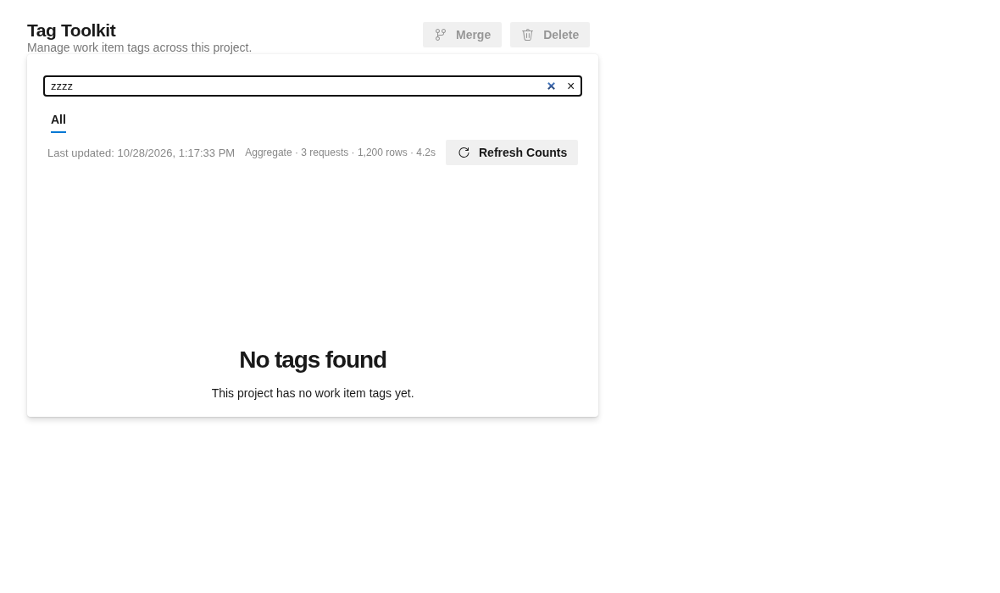
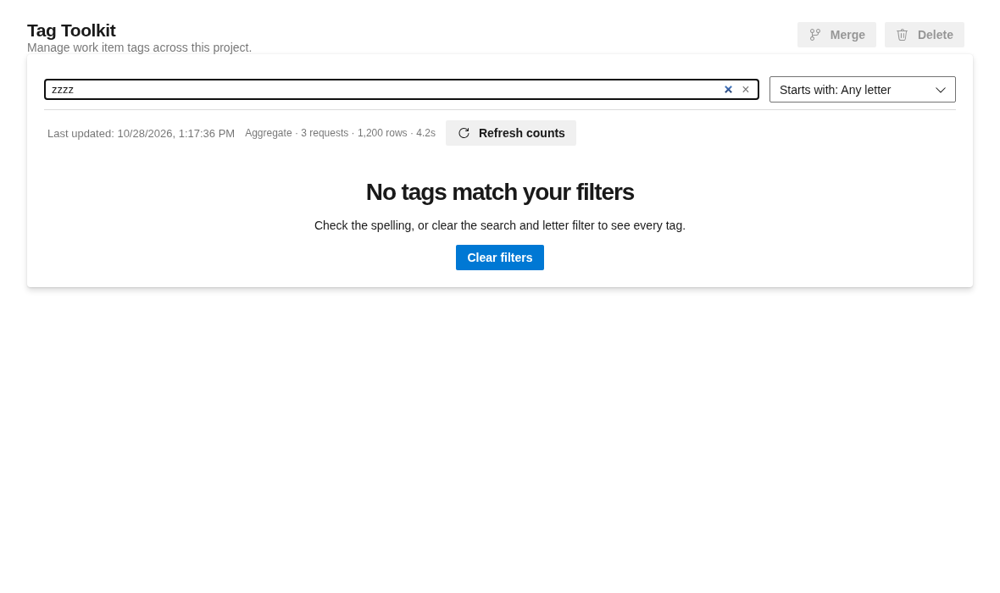
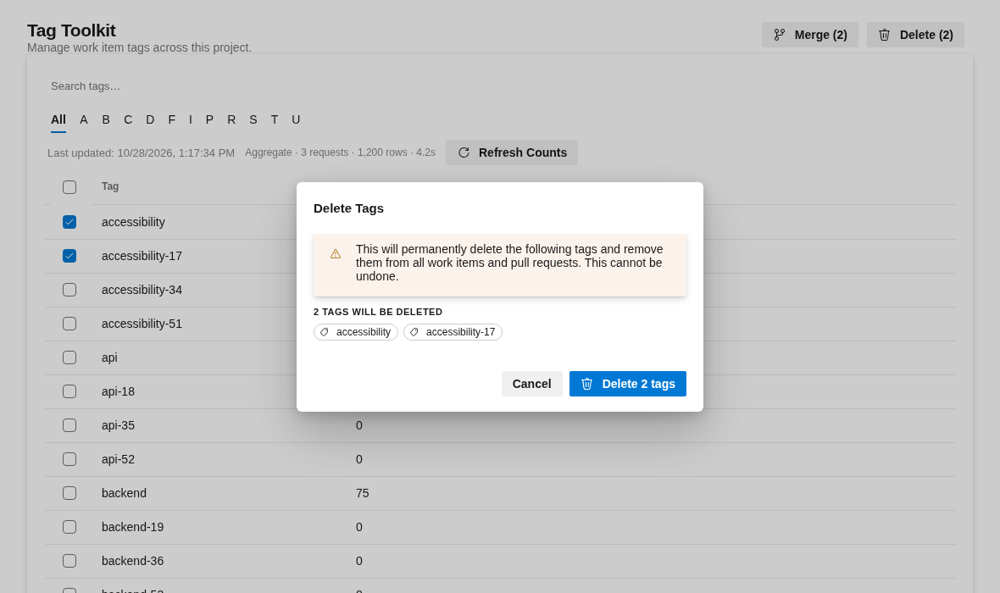
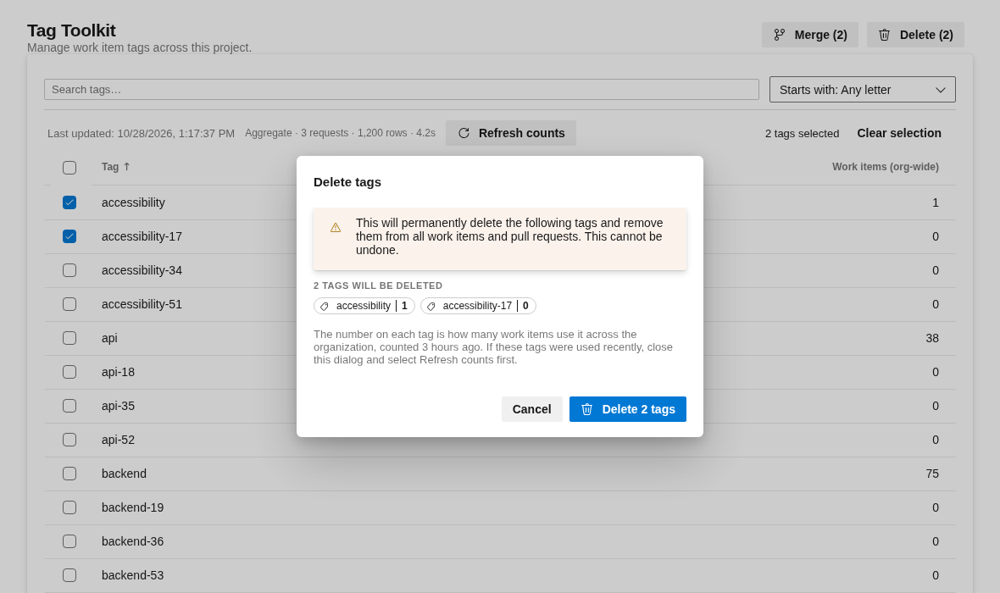
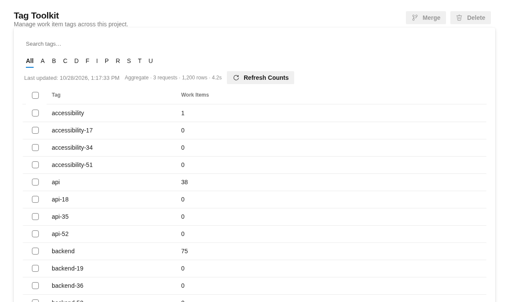
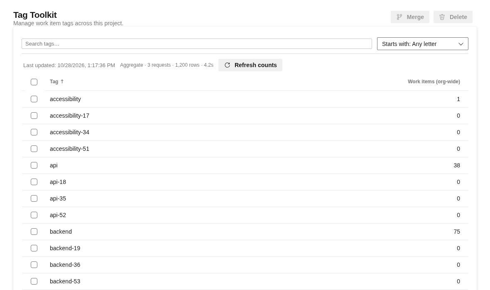

# UI review and hardening (2026-10-28)

A design review of the hub UI against Azure DevOps (ADO) standards, the fixes made from it on
`feat/ui-harden-and-clarify`, and what is deliberately left for later. This is a dated record; for
current behaviour use the root [README](../../../README.MD) and the source.

Surface: `src/app` and `src/hub`, an Operate-mode tool (people complete a task; scanability and ADO
conventions outrank expression). Users are project admins and PMs cleaning up tags, where **Merge**
and **Delete** are destructive and affect work items org-wide.

## Method

Two independent assessments, so neither anchored the other:

- **A, design review:** Nielsen heuristics, cognitive load, personas, read from source and driven in a
  browser.
- **B, deterministic evidence:** `impeccable detect`, the browser overlay, and runtime measurements
  (console errors, overflow, accessible names, target sizes, contrast, focus order).

ADO needs sign-in, so both used a local Playwright harness that renders the real `azure-devops-ui`
components with stubbed services and emulated ADO theme variables. **The harness is not in the repo**
(see [Later](#left-to-do-later)).

| Run | Score | Detector |
| --- | --- | --- |
| First (before any change) | 20/40, acceptable, low end | no findings |
| Second (after the fixes below) | 24/40, acceptable, upper end | no findings |

## What the review found

Corrections to the first run, found while fixing:

- The reported "P0 crash" (hooks called after an early return in `TagTable`) **does not crash** on
  React 16.14; it is a latent rules-of-hooks violation, fixed as such.
- `count ?? 0` does not invent counts; it is accurate as of the last refresh, so the fix was to say how
  old the numbers are.
- The ADO `Table` does not virtualize, so "swap pagination for a virtualized table" was not available.

Real problems, fixed (below): selection and select-all spanned rows not on screen; delete and merge
gave no consequence, progress or confirmation; a failed merge's error was wiped by the reload; an
empty search claimed the project had no tags; borders, hover and greys disappeared in ADO because
`--palette-*` variables were used as colours; the whole hub narrowed when content was narrow; and,
found in the second run, Enter deleted tags the moment the Delete dialog opened.

## Completed

Nine commits, in order:

| Commit | Change |
| --- | --- |
| `d24a78c` | Call `TagTable` hooks before the empty-state return. |
| `b6d617e` | Selection matches what is on screen: select-all acts on the current page only, and "N selected · M not shown" is visible. |
| `7a6e76c` | Dialogs say what a merge or delete touches and how old the counts are; unknown counts render as "—", not 0; column renamed "Work items (org-wide)". |
| `e6b448f` | Merge and delete confirm with a toast, show progress ("Deleting 2 of 5…"), keep per-tag failures visible and sanitized, keep failed tags selected, and reload behind the table. |
| `a7be809` | ADO theme tokens used correctly (`rgba(var(--palette-…))`), `#root` flex fix, selection summary moved up, sentence-case labels. |
| `a411a59` | Delete dialog: Enter no longer confirms; focus starts on Cancel; Escape handled explicitly. |
| `07b0dd3` | Card content stays full width when the table is replaced by an empty state; reserved 160px image gap removed. |
| `77b8d72` | Sort by Tag or Work items (zeros first on first choice; unknown counts always last); counts right-aligned. |
| `b00308d` | A–Z tab strip replaced by a "Starts with" dropdown; live Playwright spec ported (not run); README and overview updated. |

### Evidence

| | Before | After |
| --- | --- | --- |
| No match |  |  |
| Delete dialog |  |  |
| List |  |  |

After only: [sorted by count](assets/2026-10-28-ui-review/after-sorted.png),
[Starts with open](assets/2026-10-28-ui-review/after-starts-with-open.png).

Final state: `tsc` clean, 40 suites and 433 tests pass, `pnpm build` compiles, detector reports nothing,
and a scripted run in light and an emulated dark theme logs no console errors.

## Library behaviour worth knowing

The jest setup maps every `azure-devops-ui/*` import to one mock, so green unit tests do not prove how
the real components behave. Checking in Chromium caught these; the mock now follows the real contract
for each, so a jest test fails the way the real component does.

- `Dialog` presses its primary button on Enter by default (`enterPrimary: true`).
- `Button` swallows Escape (blurs and stops the event), so Escape is dead while a footer button has
  focus. Starting focus on Cancel therefore needs its own Escape handler (capture phase).
- `Button` namespaces `id` through `getSafeId`, so `#id` selectors match nothing; use a `className`.
- `Dropdown.renderSelectedItems` receives all items, not the selected ones. Enter on a list item leaves
  the list open; `collapse()` works only if deferred a tick.
- `Table` column `justification` moves only the header; cells need `contentClassName="justify-end"`.
- `--palette-*` variables are bare RGB triplets, and `<body>` and `.bolt-card-content` are flex
  containers, so wrappers need `flex: 1 1 auto; min-width: 0`.

## Left to do later

Ordered roughly by value. None were in scope for this round (P0/P1, then the empty state and sorting).

**Verify in the real host (not done; needs ADO access)**

- Run the live Playwright specs in `live-test/ui/specs`. `startsWithFilter.spec.ts` was ported but never
  run; its locators were only checked against the harness. Add a sorting spec.
- Dark theme against real ADO tokens (the harness theme is emulated), the colour of the `danger`
  button, whether the command bar scrolls out of view when a row halfway down is selected, and
  screen-reader output. None of these were observed.
- Confirm the Delete warning's "…and pull requests" claim. It was left unchanged and unverified, and
  may be wrong for work item tags.

**Destructive actions**

- Merge is styled `danger` exactly like Delete. Consider a neutral primary, since it keeps one tag.
- Merge still confirms on Enter once a target is typed (judged acceptable). Its footer buttons have the
  same Escape-swallowing quirk as Delete.
- No extra friction for high-count tags (for example a typed confirmation).
- After a merge the toast tells the user to refresh counts; it could refresh them instead.

**ADO-native components**

- Replace the hand-built merge-target picker and search box with ADO components (`EditableDropdown`,
  filter bar). The picker has `outline: none` (`MergeDialog.tsx`), no listbox or combobox roles, and no
  counts to show which tag is the big one. Search shows two clear icons (native plus custom).
- Row action menu (`ColumnMore`) so rename is discoverable. Rename currently commits on blur, and its
  duplicate-name error is clipped.

**Findability and efficiency**

- No select-all across pages ("select all N matching"); selection is per page.
- Small targets: 16×16 checkboxes and 16px-high rename buttons.
- Counts sit at the card edge, a long way from the tag name on wide screens.
- Tooltips on disabled Merge and Delete; wrap the page in `Surface`.

**Copy and scope**

- The header says "across this project" while counts and the delete blast radius are org-wide.
- Developer refresh diagnostics ("Aggregate · 3 requests · 1,200 rows · 4.2s") show to everyone; move
  to a tooltip.
- "Merge" is framed as deleting tags; "Keep this tag" may lower anxiety at the peak moment.

**Housekeeping**

- Commit a version of the Playwright harness (for example `scripts/ui-harness`), since it is what caught
  the library issues above.
- Decide whether `.impeccable/` (critique snapshots) is gitignored or committed. It is untracked.
- `AGENTS.md` points at a root `GLOSSARY.md` that does not exist.
- Pagination was kept (25 per page); revisit if large tag sets make it awkward now that sorting exists.
